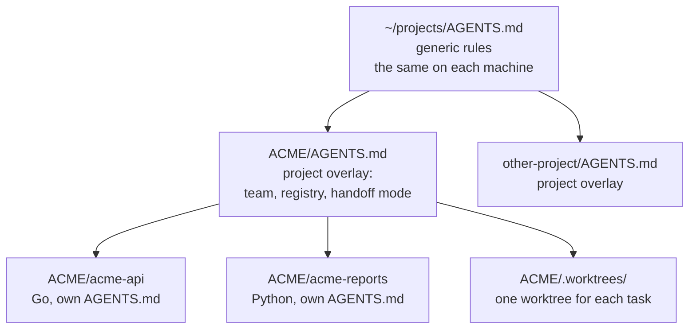
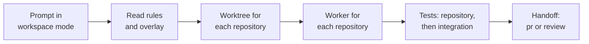
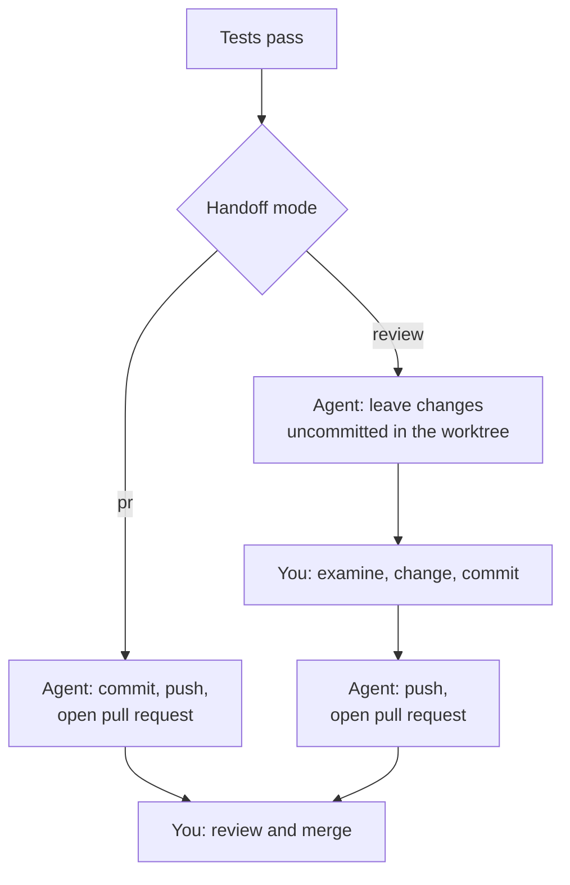

# ai-workspace

A small template for agentic work across repositories. One folder holds the rules, one overlay holds the
data of each project, and the workflow is the same on each machine.

This is the companion of the blog post on [mrcontainer.nl](https://mrcontainer.nl). It is a trimmed
version of the setup that I use each day. My full setup (skills, hooks, installer) is in a private
repository, `ai-harness-config`. You do not need it to use this template.

## The layout



| File                                | Purpose                                                         |
| ----------------------------------- | --------------------------------------------------------------- |
| [`AGENTS.md`](AGENTS.md)            | Generic rules: git, infrastructure, worktrees, verify, handoff. |
| [`ACME/AGENTS.md`](ACME/AGENTS.md)  | Example project overlay. ACME is fictional.                      |
| [`.claude/settings.json`](.claude/settings.json) | Deny rules that the harness enforces.              |
| [`examples/cross-repo-task.md`](examples/cross-repo-task.md) | One task through the full workflow.    |

## The workflow



1. Start the agent in the workspace folder and give it a task that names the project.
2. The agent reads `AGENTS.md` and the project overlay.
3. The agent makes one worktree for each repository, and gives each repository to one worker.
4. Each worker writes a test first, makes the change, and runs the repository tests.
5. The agent runs the integration test that uses the repositories together.
6. The agent does the handoff for the mode.

[`examples/cross-repo-task.md`](examples/cross-repo-task.md) shows each step.

## The handoff

One line sets how a task ends: `Handoff mode: pr` or `Handoff mode: review`. The project overlay has
precedence over the workspace file, so a careful client and a personal project can use different modes
on the same machine.



## Use it

```bash
mkdir -p ~/projects && cd ~/projects
git clone https://github.com/scholtenmartijn/ai-workspace.git /tmp/ai-workspace
cp /tmp/ai-workspace/AGENTS.md .
mkdir -p .claude && cp /tmp/ai-workspace/.claude/settings.json .claude/
mkdir <project> && cp /tmp/ai-workspace/ACME/AGENTS.md <project>/AGENTS.md
```

Then edit `<project>/AGENTS.md`: the organization, the team, the handoff mode, and the registry. Clone the
project repositories into `<project>/`. Keep real project overlays local.

## Tools

| Tool                                                    | Why                                              |
| ------------------------------------------------------- | ------------------------------------------------ |
| [Claude Code](https://code.claude.com/docs/en/overview) | The agent that I use most.                       |
| [opencode](https://opencode.ai)                         | Reads the same `AGENTS.md` and the same skills.  |
| [worktrunk](https://worktrunk.dev) (`wt`)               | One worktree for each task.                      |
| [GitHub CLI](https://cli.github.com) (`gh`)             | Pull requests from the terminal.                 |
| [rtk](https://github.com/rtk-ai/rtk)                    | Cuts the tokens of shell output.                 |

Set the worktree path in `~/.config/worktrunk/config.toml`:

```toml
worktree-path = "../.worktrees/{{ repo }}/{{ branch | sanitize }}"
```

Skills hold the procedures, so that `AGENTS.md` stays short. The ones that matter for this workflow:

- `grill-me` and `wayfinder` from [Matt Pocock's skills](https://github.com/mattpocock/skills): plan before
  you implement.
- `tdd` from the same collection: test first, then the change.
- An `adr` skill: one short record for each architecture decision.
- Language skills for each stack, for example [samber/cc](https://github.com/samber/cc) for Go.

## Things to know

- **`AGENTS.md` without `CLAUDE.md`.** Claude Code 2.1.277 or later reads `AGENTS.md` directly. It does
  this only when there is no `CLAUDE.md` in the working directory or above it. If a repository has its
  own `CLAUDE.md`, add the line `@AGENTS.md` to it, or move its content to `AGENTS.md`. See the
  [memory docs](https://code.claude.com/docs/en/memory).
- **Text is advice, deny rules are enforced.** The agent can fail to obey a rule in `AGENTS.md`. A deny
  rule in `settings.json` always applies. Use a deny rule (or a hook) for each rule that has no
  exceptions.
- **Scope of the deny rules.** Claude Code reads `.claude/settings.json` from the folder where the
  session starts. The file in this template applies to sessions that start in the workspace folder.
  For sessions that start in a repository, put the same rules in `~/.claude/settings.json`.
- **opencode.** I checked the opencode behavior against its documentation, not in a live run. opencode
  uses the first `AGENTS.md` that it finds when it goes up from the working directory. In a repository
  that has its own `AGENTS.md`, start opencode in the workspace folder to get the workspace rules.
- **Start each task with a fresh session.** A long context makes it more likely that the agent misses a
  written rule.
- **Keep the files short.** The rules file is below 200 lines. It holds only what the agent cannot find
  in the repositories.
