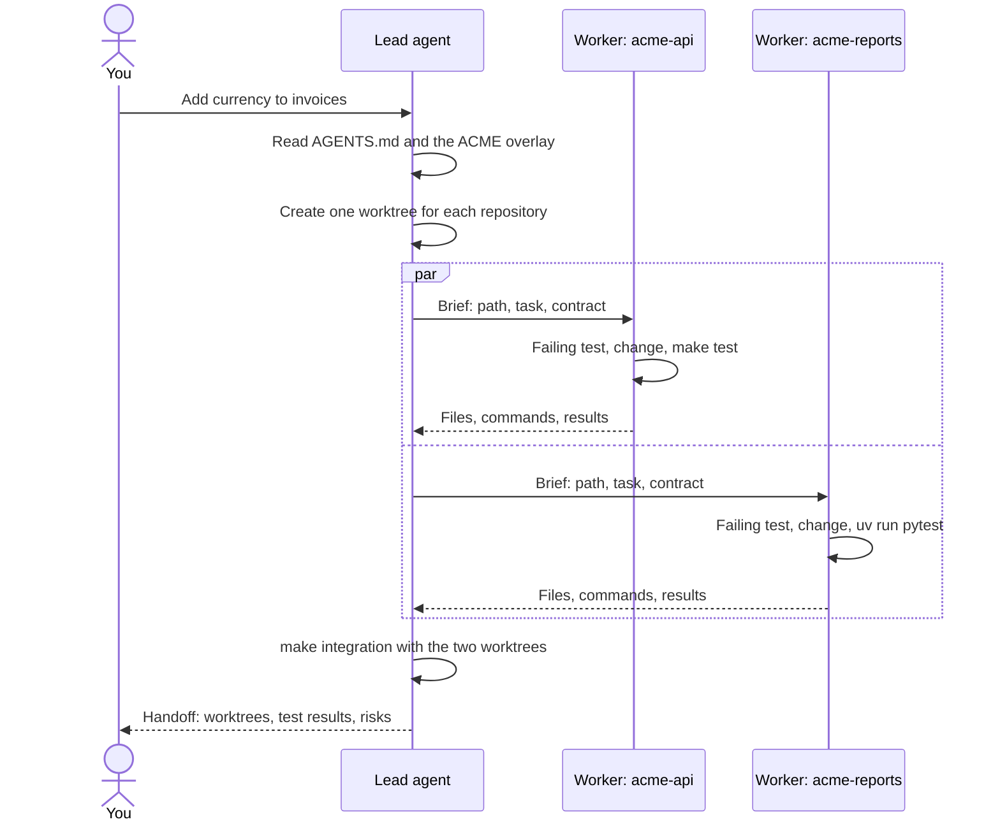
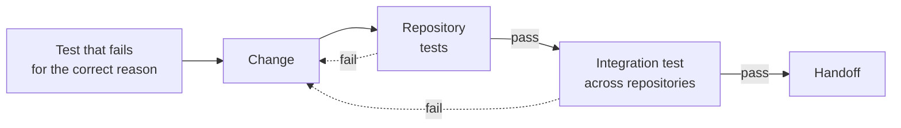

# Example: one task across two repositories

ACME, its repositories, and the output below are fictional. They show the shape of the workflow, not a
real run.

The task: invoices get a `currency` field. `acme-api` (Go) must return it, and `acme-reports` (Python)
must read it. The mode for this example is `pr`.



## 1. The prompt

Start the agent in `~/projects` and give it the task. Name the client, the repositories, and what
"done" means.

```text
Client: ACME. Use handoff mode pr for this task.

Invoices need a currency. Add a field `currency` (ISO 4217 code, string, default "EUR") to the invoice
response of acme-api. Make acme-reports group the monthly totals by currency.

Done means: the tests of the two repositories pass, and `make integration` in acme-reports passes
against the acme-api worktree.
```

## 2. The worktrees

The agent reads `AGENTS.md` and `ACME/AGENTS.md`, then makes one worktree for each repository:

```bash
cd ~/projects/ACME/acme-api     && git fetch origin && wt switch --create feat/invoice-currency
cd ~/projects/ACME/acme-reports && git fetch origin && wt switch --create feat/invoice-currency
```

```text
~/projects/ACME/.worktrees/acme-api/feat-invoice-currency
~/projects/ACME/.worktrees/acme-reports/feat-invoice-currency
```

## 3. The worker brief

Each repository gets one worker. The two briefs share the contract, so the two sides agree before a
line of code exists.

```text
Repository: ~/projects/ACME/acme-api
Worktree:   ~/projects/ACME/.worktrees/acme-api/feat-invoice-currency

Task: add `currency` to the invoice response.
Contract: JSON field `currency`, string, ISO 4217 code, default "EUR". Old invoices return "EUR".

Read ACME/AGENTS.md and the repository agent file first.
Work only in the worktree. Use absolute paths.
Write the test first. Show that it fails, then make it pass.
Report: the files that you changed, the commands that you ran, and the results.
```

## 4. Verification



The worker for `acme-api` writes the test first and runs it. It fails for the correct reason: the field
is not there.

```text
$ go test ./internal/invoice/ -run TestInvoiceResponseHasCurrency
--- FAIL: TestInvoiceResponseHasCurrency (0.00s)
    handler_test.go:41: currency: got "", want "EUR"
FAIL
```

After the change, the same test passes, and then the full test command of the repository:

```text
$ make test
ok   acme-api/internal/invoice   0.412s
ok   acme-api/internal/store     0.230s
```

The worker for `acme-reports` does the same with `uv run pytest`. Then the lead agent runs the test that
uses the two repositories together. This test is the one that finds a difference between the two sides
of the contract.

```text
$ ACME_API_PATH=~/projects/ACME/.worktrees/acme-api/feat-invoice-currency make integration
tests/integration/test_monthly_report.py::test_totals_grouped_by_currency PASSED
tests/integration/test_monthly_report.py::test_old_invoices_default_to_eur PASSED
2 passed in 8.31s
```

## 5. The handoff

```text
Task: invoice currency (ACME)

Pull requests
- acme/acme-api#101      feat: add currency to invoice response      merge first
- acme/acme-reports#57   feat: group monthly totals by currency      merge second

Worktrees
- ~/projects/ACME/.worktrees/acme-api/feat-invoice-currency
- ~/projects/ACME/.worktrees/acme-reports/feat-invoice-currency

Tests
- acme-api: make test, pass
- acme-reports: uv run pytest, pass
- integration: make integration against the acme-api worktree, 2 passed

Risks and open questions
- Old invoices have no currency in the database. The API returns "EUR" for them. Is that correct for
  the invoices of the UK office?
- acme-reports fails on an API without the field. Merge acme-api first.
```

In mode `review`, the handoff stops before the pull requests. The agent gives the two worktree paths and
the commands to examine and commit the changes, and opens the pull requests when you ask for them.

## What you do

The agent did the work, but the result is yours. Read the two diffs. Run the integration test again if
you have doubts. Answer the open questions. Then merge, `acme-api` first.
